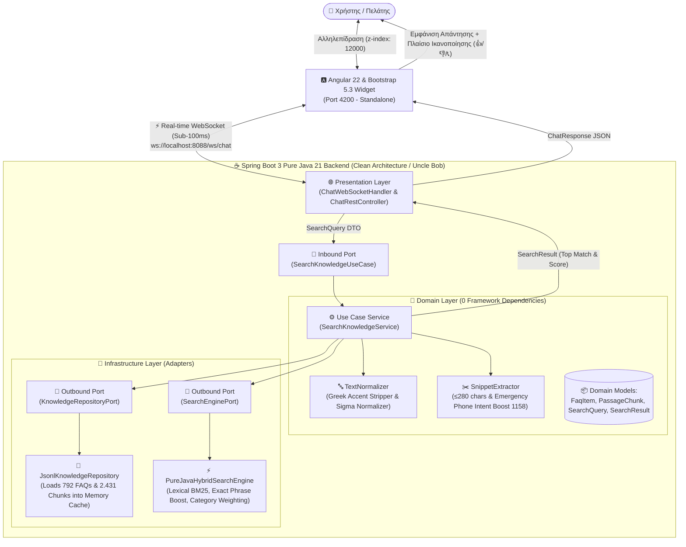

# 🏛️ Αρχιτεκτονικό Πλάνο & Προδιαγραφές Υλοποίησης: Anytime Knowledge RAG Chatbot

> **Έκδοση:** 3.0.0 (Production Pure Java Clean Architecture / Uncle Bob)  
> **Ημερομηνία Τελευταίας Ενημέρωσης:** 2026-09-28  
> **Κατάσταση:** Ολοκληρωμένο & Πλήρως Λειτουργικό (Production-Ready)  
> **Τεχνολογικό Stack:** Angular 22 + Bootstrap 5.3 (Flex-Grid) + Pure Java 21 (Spring Boot 3 WebSockets & REST) + Pure Java Hybrid Knowledge Engine

---

## 📐 Διάγραμμα Ροής & Αρχιτεκτονικής (Clean Architecture)

### 📊 Οπτικό Διάγραμμα Αρχιτεκτονικής (Visual ASCII Architecture):

```text
┌────────────────────────────────────────────────────────────────────────────────────────┐
│                              👤 ΧΡΗΣΤΗΣ / CLIENT BROWSER                              │
└───────────────────────────────────────────┬────────────────────────────────────────────┘
                                            │ (Interaction at z-index: 12000)
                                            ▼
┌────────────────────────────────────────────────────────────────────────────────────────┐
│               🅰️ ANGULAR 22 & BOOTSTRAP 5.3 STANDALONE WIDGET (Port 4200)              │
│    • Signals Reactivity: isOpen(), currentCategory(), messages()                       │
│    • Compact 4x2 Categories Grid (All 8 visible in 50px)                               │
│    • Interactive Satisfaction Flow (👍 Ναι, 👎 Όχι, 📞 1158 Contact Card)              │
└───────────────────────────────────────────┬────────────────────────────────────────────┘
                                            │ ⚡ Real-Time WebSocket (ws://localhost:8088/ws/chat)
                                            ▼
┌────────────────────────────────────────────────────────────────────────────────────────┐
│               ☕ SPRING BOOT 3 PURE JAVA 21 BACKEND (Clean Architecture)                │
│                                                                                        │
│  🌐 PRESENTATION LAYER                                                                 │
│     └─ ChatWebSocketHandler & ChatRestController (JSON DTOs & Connection Lifecycle)   │
│                                           │                                            │
│                                           ▼ (SearchQuery Inbound)                      │
│  🎯 USE CASE LAYER                                                                     │
│     ├─ SearchKnowledgeUseCase (Inbound Port)                                           │
│     ├─ SearchKnowledgeService (High-level Policy: Threshold ≥ 0.45, Single Best Answer)│
│     └─ Ports: KnowledgeRepositoryPort & SearchEnginePort (Outbound Dependency Inversion)│
│                     │                                   │                              │
│                     ▼                                   ▼                              │
│  🧠 DOMAIN LAYER                                 🔌 INFRASTRUCTURE LAYER               │
│     ├─ Entities: FaqItem, PassageChunk               ├─ JsonlKnowledgeRepository       │
│     ├─ TextNormalizer (Accent/Sigma Stripper)        │  (In-Memory Cache: 792 FAQs     │
│     └─ SnippetExtractor (≤280 chars & 1158 boost)    │   & 2.431 Contract Chunks)      │
│                                                      └─ PureJavaHybridSearchEngine     │
│                                                         (BM25, Jaccard, Phrase Match)  │
└────────────────────────────────────────────────────────────────────────────────────────┘
```

### 🔁 Mermaid Architecture Flowchart:



---

## 🧩 Ανάλυση Υποσυστημάτων (Components Breakdown)

### 1. 🅰️ Frontend: Angular 22 Standalone Widget (`UI/`)
* **Ρόλος:** Αυτόνομο (standalone) embeddable widget που ενσωματώνεται σε οποιαδήποτε ιστοσελίδα.
* **Χαρακτηριστικά & Τεχνολογίες:**
  * **Angular 22 Standalone Components & Signals:** Χρήση `signal<boolean>`, `signal<string>` και RxJS WebSockets.
  * **Bootstrap 5.3 Flex-Grid & Utilities:** Χρήση `.d-flex`, `.row`, `.col`, `.gap-*`, `.align-items-center` για καθαρό και ευέλικτο template.
  * **Compact 4x2 Grid Κατηγοριών:** Και οι 8 κατηγορίες (*🌟 Όλα, 🚗 Αυτοκίνητο, 🏠 Σπίτι, 🩺 Υγεία, 🏍️ Μηχανή, ✈️ Ταξίδι, 🔒 Cyber, 🚲 e-Bikes*) είναι **100% ορατές ταυτόχρονα** σε 2 συμπαγείς σειρές των 4 στηλών, καταλαμβάνοντας μόλις ~50px ύψος.
  * **Διαδραστικό Σύστημα Ικανοποίησης (Satisfaction Feedback):**
    * Ερώτηση: *«💬 Σας κάλυψε η παραπάνω απάντηση;»*
    * Κουμπιά: `👍 Ναι, με κάλυψε`, `👎 Όχι, ψάχνω κάτι άλλο`, `📞 Επικοινωνία`.
    * Αυτόματα follow-up μηνύματα και προτεινόμενες ερωτήσεις.
  * **Κάρτα Επικοινωνίας Anytime:** Άμεση κλήση στο [1158](tel:1158) (Οδική Βοήθεια 24/7), [210 94 60000](tel:2109460000) και συνδέσεις my.anytime.gr.
  * **Απομόνωση Επιπέδου (`z-index: 12000`):** Δεν συγκρούεται με τα styles της κύριας ιστοσελίδας.

---

### 2. ☕ Backend: Pure Java 21 / Spring Boot 3 (`BACKEND_JAVA/`)
* **Ρόλος:** Κεντρικός διακομιστής WebSocket & REST, υλοποιημένος **100% σε Pure Java** με **Clean Architecture & SOLID Principles (Uncle Bob)**.
* **Αρχιτεκτονικά Επίπεδα (Layering):**
  1. **Domain Layer (`domain`):**
     * `FaqItem`, `PassageChunk`, `SearchQuery`, `SearchResult` (Immutable Records).
     * `TextNormalizer`: [SRP] Αφαίρεση ελληνικών τόνων, πεζοποίηση και κανονικοποίηση τελικού σίγμα (`ς` $\to$ `σ`).
     * `SnippetExtractor`: [SRP] Εξαγωγή της καταλληλότερης πρότασης $\le 280$ χαρακτήρων με ανίχνευση τηλεφώνων ανάγκης (`1158`, `210 94 60000`).
  2. **Use Case Layer (`usecase`):**
     * Inbound Port: `SearchKnowledgeUseCase`.
     * Outbound Ports: `KnowledgeRepositoryPort`, `SearchEnginePort`.
     * Service: `SearchKnowledgeService` ([DIP] Εφαρμογή threshold $\ge 0.45$ και Single Best Answer Policy).
  3. **Infrastructure Layer (`infrastructure`):**
     * `JsonlKnowledgeRepository`: [LSP] Φόρτωση 792 verified FAQs & 2.431 Chunks σε ασφαλή in-memory δομή.
     * `PureJavaHybridSearchEngine`: [OCP] Lexical BM25, Exact Phrase Boost & Category Prioritization.
  4. **Presentation Layer (`controller`):**
     * `ChatWebSocketHandler`: Real-time WebSocket streaming (`ws://localhost:8088/ws/chat`).
     * `ChatRestController`: REST APIs (`/api/chat`, `/api/health`).

---

### 3. 🧠 Hybrid Knowledge Retrieval Engine (Pure Java Engine)
* **100% Extractive / Zero Hallucination:** Επιστροφή αποκλειστικά αυθεντικών αποσπασμάτων συμβολαίων και επίσημων FAQs.
* **Category Prioritization:** Εφαρμογή συντελεστών βαρύτητας ανά κατηγορία (`car_insurance: 1.35`, `home_property_insurance: 1.25`, `health_insurance: 1.25`, `moto: 1.20`, `truck_agro: 0.60`).
* **Intelligent Snippet Slicing:** Σύντομη, περιεκτική απάντηση $\le 280$ χαρακτήρων με άμεσο link στην επίσημη σελίδα/PDF.
* **Μηδενική Εξάρτηση από Python στο Runtime:** Το backend εκτελείται αυτόνομα ως ενιαίο Java process.

---

## 📋 Ολοκληρωμένα Στάδια Υλοποίησης (Implementation Milestones)

```text
┌────────────────────────────────────────────────────────────────────────┐
│ [✔] ΦΑΣΗ 1: Επεξεργασία Dataset & RAG Chunks                          │
│  - Εξαγωγή 792 επαληθευμένων FAQs & 2.431 συμβολαιακών chunks.         │
├────────────────────────────────────────────────────────────────────────┤
│ [✔] ΦΑΣΗ 2: Angular 22 + Bootstrap 5.3 Standalone Widget               │
│  - Responsive UI σε z-index 12000, 4x2 compact categories grid.        │
│  - Σύστημα αξιολόγησης (👍/👎/📞) & κάρτα επικοινωνίας 24/7.           │
├────────────────────────────────────────────────────────────────────────┤
│ [✔] ΦΑΣΗ 3: Μετάβαση σε Pure Java 21 Clean Architecture (Uncle Bob)    │
│  - Πλήρης διαχωρισμός σε Domain, UseCase, Infrastructure, Presentation.│
│  - Υλοποίηση Pure Java BM25 Search Engine & Greek Text Normalizer.     │
├────────────────────────────────────────────────────────────────────────┤
│ [✔] ΦΑΣΗ 4: Unit Testing & Επαλήθευση (JUnit 5 & Mockito)              │
│  - 100% Pass σε όλα τα tests (TextNormalizer, SnippetExtractor, κ.λπ.) │
│  - Live WebSocket & REST APIs στο port 8088.                           │
└────────────────────────────────────────────────────────────────────────┘
```

---

© 2026 Anytime.gr Knowledge Retrieval System. All Rights Reserved.
