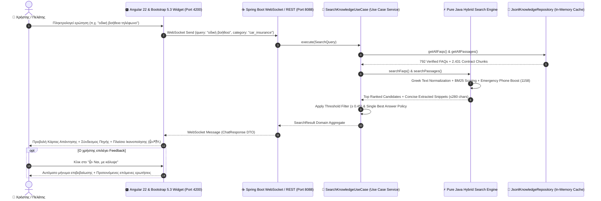

# 📘 Anytime.gr Hybrid Knowledge RAG System — Technical Documentation & Architecture Manual

> **Έκδοση:** 3.0.0 (Pure Java Clean Architecture / Uncle Bob)  
> **Ημερομηνία:** 2026-09-28  
> **Αρχιτεκτονική:** 100% Pure Extractive Retrieval (Clean Architecture & SOLID Principles by Uncle Bob)  
> **Τεχνολογικό Stack:** Angular 22 + Bootstrap 5.3 (Flex-Grid) + Pure Java 21 (Spring Boot 3 WebSockets / REST / Gradle Groovy) + Pure Java Hybrid Knowledge Engine (Greek Text Normalizer + BM25 + Exact Phrase Match + Snippet Slicer)  
> **🏆 Master Παρουσίαση Έργου:** [PROJECT_PRESENTATION_MASTER.md](PROJECT_PRESENTATION_MASTER.md)  

---

## 📑 Πίνακας Περιεχομένων
1. [Εισαγωγή & Φιλοσοφία Συστήματος](#1-εισαγωγή--φιλοσοφία-συστήματος)
2. [Αρχές Clean Architecture & SOLID (Uncle Bob)](#2-αρχές-clean-architecture--solid-uncle-bob)
3. [Συνολική Αρχιτεκτονική & Διάγραμμα Ροής (Mermaid)](#3-συνολική-αρχιτεκτονική--διάγραμμα-ροής)
4. [Δομή Φακέλων Έργου (Folder Structure)](#4-δομή-φακέλων-έργου)
5. [Ανάλυση Επιπέδων (Layer-by-Layer Breakdown)](#5-ανάλυση-επιπέδων)
   - [5.1 Domain Layer (`domain`)](#51-domain-layer-domain)
   - [5.2 Use Case Layer (`usecase`)](#52-use-case-layer-usecase)
   - [5.3 Infrastructure Layer (`infrastructure`)](#53-infrastructure-layer-infrastructure)
   - [5.4 Presentation Layer (`controller`)](#54-presentation-layer-controller)
   - [5.5 Frontend Widget σε Angular 22 & Bootstrap 5.3 (`UI/`)](#55-frontend-widget-σε-angular-22--bootstrap-53)
6. [Διαδραστικό Σύστημα Ικανοποίησης & Επικοινωνίας (Feedback System)](#6-διαδραστικό-σύστημα-ικανοποίησης--επικοινωνίας)
7. [Συμβάσεις & Προδιαγραφές API (API Contracts)](#7-συμβάσεις--προδιαγραφές-api)
8. [Οδηγός Εγκατάστασης, Εκκίνησης & Tests](#8-οδηγός-εγκατάστασης-εκκίνησης--tests)
9. [Συντήρηση & Επίλυση Προβλημάτων](#9-συντήρηση--επίλυση-προβλημάτων)

---

## 1. Εισαγωγή & Φιλοσοφία Συστήματος

Το σύστημα **Anytime.gr Hybrid Knowledge RAG Chatbot** σχεδιάστηκε για να παρέχει άμεση, έγκυρη και 100% αυθεντική πληροφόρηση σχετικά με τα ασφαλιστήρια συμβόλαια, τους όρους καλύψεων, τις διαδικασίες αποζημιώσεων και τις συχνές ερωτήσεις (FAQs) της Anytime Interamerican.

### 🛡️ Βασικοί Πυλώνες Σχεδιασμού:
1. **100% Extractive / Zero Hallucination:**  
   Δεν χρησιμοποιείται παραγωγικό LLM (Generative AI) που θα μπορούσε να παραποιήσει όρους συμβολαίων ή ποσά αποζημιώσεων. Το σύστημα εντοπίζει και επιστρέφει **αυτούσια τα αποσπάσματα των επίσημων συμβολαίων και τα επίσημα FAQs** με άμεσο σύνδεσμο (PDF / Web URL) προς την επίσημη πηγή.
2. **Single Best Answer Principle:**  
   Επιστρέφει την κορυφαία, απόλυτα σχετική απάντηση σε μορφή σύντομης σύνοψης ($\le 280$ χαρακτήρες) ώστε ο χρήστης να λαμβάνει την ουσία χωρίς περιττό κείμενο.
3. **Υψηλό Κατώφλι Συνάφειας (Relevance Threshold $\ge 0.45$):**  
   Αν μια ερώτηση δεν σχετίζεται με ασφάλειες Anytime, το σύστημα δεν παράγει τυχαίες απαντήσεις αλλά καθοδηγεί τον χρήστη σε επίσημα θέματα.
4. **Standalone Web Widget (`z-index: 12000`):**  
   Το frontend είναι κατασκευασμένο σε **Angular 22** με **Bootstrap 5.3 Flex-Grid** και **Compact 4x2 Responsive Grid**, πλήρως responsive σε mobile και desktop συσκευές.
5. **Pure Java 21 Backend (Clean Architecture):**  
   Το backend εκτελείται αυτόνομα σε Java 21 & Spring Boot 3, χωρίς καμία εξάρτηση από εξωτερικά processes ή Python στο runtime.

---

## 2. Αρχές Clean Architecture & SOLID (Uncle Bob)

Η μηχανή ανάκτησης και το backend έχουν υλοποιηθεί πλήρως σε **Pure Java 21**, ακολουθώντας πιστά τις αρχές του **Uncle Bob (Robert C. Martin)**:

```
┌──────────────────────────────────────────────────────────┐
│                   PRESENTATION LAYER                     │
│    (ChatRestController, ChatWebSocketHandler, DTOs)     │
├──────────────────────────────────────────────────────────┤
│                     USE CASE LAYER                       │
│    (SearchKnowledgeUseCase, Inbound & Outbound Ports)    │
├──────────────────────────────────────────────────────────┤
│                      DOMAIN LAYER                        │
│   (FaqItem, PassageChunk, TextNormalizer, SnippetExtractor)│
├──────────────────────────────────────────────────────────┤
│                  INFRASTRUCTURE LAYER                    │
│   (JsonlKnowledgeRepository, PureJavaHybridSearchEngine) │
└──────────────────────────────────────────────────────────┘
```

### 🏛️ Εφαρμογή των Αρχών SOLID:
1. **S — Single Responsibility Principle (SRP):**
   * Κάθε κλάση έχει **έναν και μοναδικό λόγο αλλαγής**:
     * `TextNormalizer`: Αποκλειστικά υπεύθυνο για αφαίρεση ελληνικών τόνων, πεζοποίηση και κανονικοποίηση σίγμα (`ς` $\to$ `σ`).
     * `SnippetExtractor`: Αποκλειστικά υπεύθυνο για την εξαγωγή της πιο πυκνής πρότασης ($\le 280$ χαρακτήρες) και την αναγνώριση τηλεφωνικών προθέσεων (1158, 210 94 60000).
     * `SearchKnowledgeService`: Συντονιστής του Use Case και εφαρμογής των ορίων συνάφειας ($\ge 0.45$).
2. **O — Open-Closed Principle (OCP):**
   * Το σύστημα είναι ανοικτό για επέκταση και κλειστό για τροποποίηση μέσω των Ports (`SearchEnginePort`, `KnowledgeRepositoryPort`).
3. **L — Liskov Substitution Principle (LSP):**
   * Οποιαδήποτε υλοποίηση του `SearchEnginePort` ή του `KnowledgeRepositoryPort` μπορεί να αντικατασταθεί χωρίς να σπάσει η λειτουργία των Use Cases.
4. **I — Interface Segregation Principle (ISP):**
   * Συμπαγή, εξειδικευμένα interfaces (`SearchKnowledgeUseCase`, `KnowledgeRepositoryPort`, `SearchEnginePort`) χωρίς περιττές μεθόδους.
5. **D — Dependency Inversion Principle (DIP):**
   * Τα υψηλού επιπέδου Use Cases δεν εξαρτώνται από Frameworks ή Controllers, αλλά **αποκλειστικά από αφηρημένα interfaces (Ports)**.

---

## 3. Συνολική Αρχιτεκτονική & Διάγραμμα Ροής

### 📊 Οπτικό Διάγραμμα Ροής (Visual Sequence Flow):

```text
┌──────────────────────────────────────────────────────────────────────────────────────────────────────────────────┐
│                                 ΔΙΑΓΡΑΜΜΑ ΡΟΗΣ ΕΠΙΚΟΙΝΩΝΙΑΣ BACKEND & FRONTEND                                   │
├───────────────┬────────────────────────┬──────────────────────┬────────────────────────┬─────────────────────────┤
│  👤 ΧΡΗΣΤΗΣ   │ 🅰️ ANGULAR 22 WIDGET │ ☕ SPRING BOOT WS    │ 🎯 USE CASE SERVICE    │ 📁 MEMORY CACHE & BM25  │
│  (Client App) │ (Signals / Port 4200)  │ (Controller / 8088)  │ (Domain Rules & Ports) │ (792 FAQs & 2.431 Chks) │
├───────────────┼────────────────────────┼──────────────────────┼────────────────────────┼─────────────────────────┤
│               │                        │                      │                        │                         │
│               │ ── 1. WS Connect ────> │                      │                        │                         │
│               │ <── 2. WS Connected ── │                      │                        │                         │
│               │    (Status: ONLINE)    │                      │                        │                         │
│               │                        │                      │                        │                         │
│ ── 3. Ερώτηση ─> [isSearching = true]  │                      │                        │                         │
│ ("οδική       │                        │                      │                        │                         │
│  βοήθεια")    │ ── 4. JSON Payload ──> │                      │                        │                         │
│               │    {query, category}   │ ── 5. execute() ───> │                        │                         │
│               │                        │                      │ ── 6. Load Cache ────> │                         │
│               │                        │                      │ <── 7. Chunks & FAQs ─ │                         │
│               │                        │                      │                        │                         │
│               │                        │                      │ ── 8. BM25 + Boost ──> │                         │
│               │                        │                      │ <── 9. Scored Items ── │ (Phone Boost: 1158)     │
│               │                        │                      │                        │                         │
│               │                        │                      │ [Filter: Score ≥ 0.45] │                         │
│               │                        │                      │ [Single Best Answer]   │                         │
│               │                        │ <── 10. Result ───── │                        │                         │
│               │ <── 11. ChatResponse ─ │                      │                        │                         │
│               │                        │                      │                        │                         │
│ <── 12. Κάρτα ┴ [isSearching = false]  │                      │                        │                         │
│  Απάντησης + Πηγή + 👍/👎/📞           │                      │                        │                         │
└──────────────────────────────────────────────────────────────────────────────────────────────────────────────────┘
```

### 🔁 Mermaid Sequence Diagram:



---

## 4. Δομή Φακέλων Έργου

```
g:/WIDGET-UI/
│
├── DOCUMENTATION.md                # 📘 Το παρόν αναλυτικό εγχειρίδιο τεκμηρίωσης
├── ARCHITECTURE_PLAN.md            # Αρχιτεκτονικές προδιαγραφές Clean Architecture
├── start_system.py                 # Κεντρικό Python launcher script
├── start_system.bat                # Batch αρχείο για άμεση εκκίνηση σε Windows
├── build_rag_dataset.py            # Script επεξεργασίας & δημιουργίας των RAG chunks
├── crawler_discovery.py            # Crawler ιστοσελίδων Anytime
├── crawl_blog_articles.py          # Crawler άρθρων & οδηγών Anytime Blog
│
├── anytime_rag_dataset/            # 📁 Κεντρικό Dataset
│   ├── raw_pdfs/                   # Αυθεντικά PDF συμβολαίων Anytime
│   ├── extracted_text/             # Καθαρισμένο εξαγόμενο κείμενο ανά έγγραφο
│   └── rag_ready_chunks/           # Τελικά JSONL αρχεία έτοιμα για RAG
│       ├── faq_qa_pairs.jsonl      # 792 επίσημα επαληθευμένα FAQ pairs
│       └── chunks.jsonl            # 2.431 αποσπάσματα νομικών όρων συμβολαίων
│
├── BACKEND_JAVA/                   # 📁 Spring Boot 3 Backend (Pure Java 21 Clean Architecture)
│   ├── build.gradle                # Gradle Build Script (Groovy DSL - Spring Boot 3, WebSocket, Jackson, JUnit 5)
│   ├── settings.gradle             # Gradle Settings (Groovy DSL)
│   ├── gradlew.bat / gradlew       # Gradle Wrapper
│   └── src/
│       ├── main/java/com/anytime/chatbot/
│       │   ├── AnytimeChatbotApplication.java
│       │   ├── domain/             # 🧠 Domain Layer
│       │   │   ├── model/          # FaqItem, PassageChunk, SearchQuery, SearchResult
│       │   │   └── service/        # TextNormalizer, SnippetExtractor
│       │   ├── usecase/            # 🎯 Use Case Layer
│       │   │   ├── port/in/        # SearchKnowledgeUseCase
│       │   │   ├── port/out/       # KnowledgeRepositoryPort, SearchEnginePort
│       │   │   └── impl/           # SearchKnowledgeService
│       │   ├── infrastructure/     # 🔌 Infrastructure Layer
│       │   │   └── adapter/        # JsonlKnowledgeRepository, PureJavaHybridSearchEngine
│       │   └── controller/         # 🌐 Presentation Layer
│       │       ├── ChatRestController.java
│       │       └── ChatWebSocketHandler.java
│       └── test/java/com/anytime/chatbot/ # 🧪 Unit & Integration Tests
│           ├── domain/service/     # TextNormalizerTest, SnippetExtractorTest
│           └── usecase/impl/       # SearchKnowledgeServiceTest
│
└── UI/                             # 📁 Standalone Frontend σε Angular 22 & Bootstrap 5.3
    ├── package.json                # Angular 22 & Bootstrap 5.3 dependencies
    ├── angular.json                # Angular CLI build configuration
    ├── dist/                       # Production build (`dist/anytime-chatbot-ui/browser`)
    └── src/app/
        ├── models/                 # TypeScript Interfaces (ChatMessage, CategoryOption)
        ├── services/               # WebSocketChatService (Reactive RxJS)
        └── components/chat-widget/ # ChatWidgetComponent (HTML, SCSS, TS)
```

---

## 5. Ανάλυση Επιπέδων (Layer-by-Layer Breakdown)

### 5.1 Domain Layer (`domain`)
* **`FaqItem` & `PassageChunk`:** Immutable Java Records που αναπαριστούν τα βασικά επιχειρησιακά δεδομένα χωρίς καμία εξάρτηση από frameworks.
* **`TextNormalizer`:** Αφαιρεί όλους τους ελληνικούς τόνους (`ά` $\to$ `α`, `έ` $\to$ `ε`, κ.λπ.), μετατρέπει όλα τα γράμματα σε πεζά, κανονικοποιεί το τελικό σίγμα (`ς` $\to$ `σ`) και αφαιρεί τα περιττά stopwords.
* **`SnippetExtractor`:** Εντοπίζει την καταλληλότερη πρόταση $\le 280$ χαρακτήρων, ενισχύοντας αυτόματα προτάσεις με τηλέφωνα έκτακτης ανάγκης (`1158`, `210 94 60000`, `801 11 30000`) όταν ο χρήστης ζητά τηλέφωνα ή οδική βοήθεια.

### 5.2 Use Case Layer (`usecase`)
* **`SearchKnowledgeUseCase` (Inbound Port):** Το συμβόλαιο εισόδου για την εκτέλεση αναζήτησης.
* **`KnowledgeRepositoryPort` & `SearchEnginePort` (Outbound Ports):** Αφηρημένες διεπαφές για την ανάκτηση και βαθμολόγηση δεδομένων.
* **`SearchKnowledgeService`:** Ο πυρήνας της εφαρμογής που συντονίζει τη ροή, εφαρμόζει το κατώφλι συνάφειας $\ge 0.45$ και επιλέγει την κορυφαία απάντηση (Single Best Answer).

### 5.3 Infrastructure Layer (`infrastructure`)
* **`JsonlKnowledgeRepository`:** Διαβάζει σε UTF-8 streaming τα αρχεία `faq_qa_pairs.jsonl` (792 FAQs) και `chunks.jsonl` (2.431 Chunks) κατά την εκκίνηση και τα διατηρεί σε ταχύτατη μνήμη cache.
* **`PureJavaHybridSearchEngine`:** Υλοποιεί Lexical BM25, Exact Phrase Match Boost, Jaccard Token Overlap και Category Prioritization Weights (`car_insurance: 1.35`, `home_property_insurance: 1.25`, `health_insurance: 1.25`, `truck_agro: 0.60`).

### 5.4 Presentation Layer (`controller`)
* **`ChatWebSocketHandler`:** Διαχειρίζεται αμφίδρομες real-time συνδέσεις (`ws://localhost:8088/ws/chat`) με sub-100ms latency.
* **`ChatRestController`:** Παρέχει REST endpoints (`POST /api/chat` και `GET /api/health`).

### 5.5 Frontend Widget σε Angular 22 & Bootstrap 5.3 (`UI/`)
* **Bootstrap 5.3 Flex-Grid Utilities:** Καθαρή δόμηση με `.d-flex`, `.row`, `.col`, `.gap-*`, `.align-items-center`.
* **Compact 4x2 Grid Κατηγοριών:** Όλα τα 8 κουμπιά κατηγοριών (*🌟 Όλα, 🚗 Αυτοκίνητο, 🏠 Σπίτι, 🩺 Υγεία, 🏍️ Μηχανή, ✈️ Ταξίδι, 🔒 Cyber, 🚲 e-Bikes*) είναι **100% ορατά ταυτόχρονα** σε 2 σειρές των 4 στηλών, καταλαμβάνοντας μόλις ~50px.
* **Απομόνωση Επιπέδου (`z-index: 12000`):** Floating widget με αυτόνομη λειτουργία.

---

## 6. Διαδραστικό Σύστημα Ικανοποίησης & Επικοινωνίας

Κάθε απάντηση συνοδεύεται από πλαίσιο ανατροφοδότησης:

```
┌────────────────────────────────────────────────────────────────────────┐
│  💬 Σας κάλυψε η παραπάνω απάντηση;                                   │
│  [ 👍 Ναι, με κάλυψε ]   [ 👎 Όχι, ψάχνω κάτι άλλο ]   [ 📞 Επικοινωνία ]│
└────────────────────────────────────────────────────────────────────────┘
```

1. **`👍 Ναι, με κάλυψε`:** Επιβεβαιώνει την ικανοποίηση του χρήστη και εμφανίζει αυτόματα έτοιμες προτεινόμενες ερωτήσεις για επόμενη αναζήτηση.
2. **`👎 Όχι, ψάχνω κάτι άλλο`:** Προτείνει εναλλακτικές διατυπώσεις και άμεση πρόσβαση στα τηλέφωνα εξυπηρέτησης.
3. **`📞 Επικοινωνία`:** Ανοίγει την κάρτα άμεσης κλήσης με:
   * 🚨 **Οδική Βοήθεια & Ατυχήματα (24/7):** [1158](tel:1158) & [210 94 60000](tel:2109460000).
   * 💬 **Εξυπηρέτηση Πελατών:** [210 94 60000](tel:2109460000) (Δευτ-Παρ 09:00 - 17:00).
   * 📧 **Email & Διαχείριση:** [info@anytime.gr](mailto:info@anytime.gr) και [my.anytime.gr](https://my.anytime.gr).

---

## 7. Συμβάσεις & Προδιαγραφές API

### 7.1 REST API Endpoint (`POST http://localhost:8088/api/chat`)

#### Request Payload:
```json
{
  "query": "Ποιο είναι το τηλέφωνο για την οδική βοήθεια;",
  "category": "car_insurance"
}
```

#### Response Payload:
```json
{
  "status": "success",
  "query": "Ποιο είναι το τηλέφωνο για την οδική βοήθεια;",
  "category_filter": "car_insurance",
  "faqs": [
    {
      "question": "Πώς καλώ την οδική βοήθεια;",
      "answer": "Η Οδική Βοήθεια της Interamerican είναι δίπλα σου 24 ώρες το 24ωρο στο 1158 (από κινητό και σταθερό) ή στο 210 9461333.",
      "source_url": "https://www.anytime.gr/info/faq"
    }
  ],
  "passages": [
    {
      "chunk_id": "chk_pdf_car_standard_001",
      "doc_title": "Όροι Ασφάλισης Αυτοκινήτου Standard Drive",
      "category": "car_insurance",
      "subcategory": "road_assistance",
      "doc_type": "terms",
      "source_type": "pdf",
      "source_url": "https://www.anytime.gr/docs/car_terms.pdf",
      "chunk_index": 1,
      "vector_score": 0.95,
      "bm25_score": 0.95,
      "rrf_score": 0.95,
      "passage_text": "Σε περίπτωση βλάβης ή ατυχήματος καλέστε άμεσα την Οδική Βοήθεια στο 1158 όλο το 24ωρο."
    }
  ],
  "total_results": 2,
  "timestamp": 1790611939
}
```

---

### 7.2 WebSocket Protocol (`ws://localhost:8088/ws/chat`)

* **Client Message (JSON):**
  ```json
  {
    "query": "Ποιες είναι οι προϋποθέσεις για την έκπτωση στον ΕΝΦΙΑ;",
    "category": "home_property_insurance"
  }
  ```
* **Server Message (JSON):** Επιστρέφει το αντίστοιχο `ChatResponse` DTO σε πραγματικό χρόνο.

---

## 8. Οδηγός Εγκατάστασης, Εκκίνησης & Tests

### 8.1 Εκκίνηση με 1 Εντολή
Από τον κεντρικό φάκελο `g:/WIDGET-UI/`:

```powershell
python start_system.py
```
*(ή διπλό κλικ στο `start_system.bat`)*

### 8.2 Εκτέλεση Unit Tests (JUnit 5 & Mockito)
```powershell
cd BACKEND_JAVA
.\gradlew.bat test
```
* **Αποτέλεσμα:** `4 actionable tasks: 4 executed` $\to$ **BUILD SUCCESSFUL**.

### 8.3 Δημιουργία Fat JAR (bootJar)
```powershell
cd BACKEND_JAVA
.\gradlew.bat bootJar
```
* **Αποτέλεσμα:** Παράγει το αυτόνομο εκτελέσιμο `BACKEND_JAVA/build/libs/anytime-chatbot-backend-3.0.0.jar`.

---

## 9. Συντήρηση & Επίλυση Προβλημάτων

* **Επανεκτέλεση Build UI:** `cd UI && npm run build`
* **Health Check Backend:** `curl http://localhost:8088/api/health`
* **Προσθήκη Νέων FAQs:** Προσθέστε νέα Q&A ζεύγη στο `anytime_rag_dataset/rag_ready_chunks/faq_qa_pairs.jsonl` και κάντε restart το backend.

---

© 2026 Anytime.gr Knowledge Retrieval System. All Rights Reserved.
